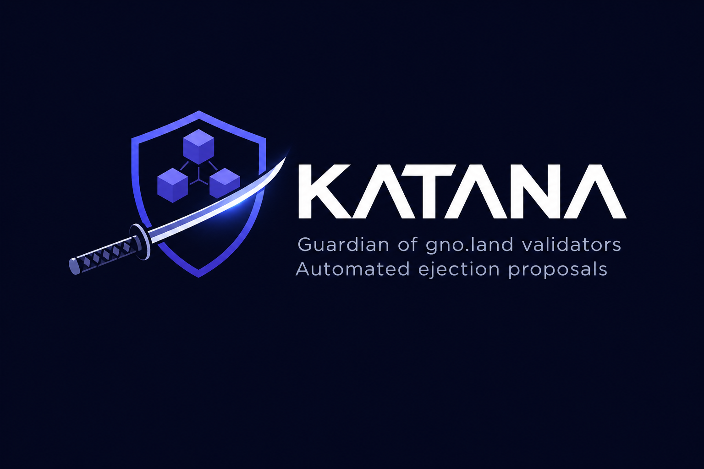

**katana** is a continuously running backend that watches
[gno.land](https://gno.land) validators and, based on a computed health score,
produces a GovDAO proposal to eject, lower, or raise a validator's voting
power — then follows the vote outcome and notifies on the result.

It reads validator health from a running
[gnomonitoring](https://github.com/samouraiworld/gnomonitoring) instance, is
multi-chain (testnet, betanet, mainnet, …), and is driven entirely by a single
`config.yaml`.

> See [prd.md](prd.md) for the full product specification.

---

## How it works

katana is a **daemon**. For every enabled chain it runs two workers on
independent tickers:

```
                         ┌──────────── katana daemon ────────────┐
 gnomonitoring API ──────┤ eval-worker(chain)  every poll_interval │
   /api/reports/validators│  evaluate → gate → proposal → notify   │
                         │                                          │
 gno.land RPC ───────────┤ vote-worker(chain)  every vote_poll_...  │
   /validators, GovDAO   │   poll GovDAO status → accepted/rejected │
                         └──────────────────────────────────────────┘
        SIGINT/SIGTERM → graceful shutdown
```

**Evaluation worker** (every `poll_interval`):
1. Assert the node still reports the configured `chain_id` (`/status`
   `node_info.network`); on mismatch — typically a testnet genesis reset —
   skip the cycle cleanly.
2. Pull each validator's computed health score (and sub-metrics) per
   reporting window from gnomonitoring.
3. Evaluate each validator against `proposal.action_priority`, in order,
   picking at most one action (`eject` / `lower_vp` / `raise_vp`) — see
   [Score-driven actions](#score-driven-actions).
4. Skip exceptions and validators blocked by the lifecycle gate (pending /
   accepted / cooldown / rejection backoff).
5. Confirm the target is in the live consensus valset.
6. Re-assert the chain id, then sign & broadcast via `gnokey`, capture the
   on-chain proposal id, and send a notification — or, on a `dry_run: true`
   chain, log + notify the would-be proposal without broadcasting (see
   [Rehearsal / dry-run](#rehearsal--dry-run)).

**Vote worker** (every `vote_poll_interval`): polls the GovDAO page of each
proposal katana broadcast, and on resolution notifies + updates state:
- **accepted** → validator removed from the valset;
- **rejected** (the realm says *denied*) → validator kept; re-proposal
  suppressed for `rejected_backoff`, and stopped entirely after `max_rejections`.

GovDAO v3 only decides a proposal when someone calls
`gno.land/r/gov/dao.ExecuteProposal` after YES or NO reached the 66.66%
supermajority; a NO majority alone resolves nothing, and proposals never expire
on-chain. So the vote worker also:
- calls `ExecuteOrRejectProposal(pid)` with katana's key when the page shows a
  supermajority (`vote_tracking.execute_proposals`, default `true`, per-chain
  override; retried at most hourly). An executor that returns an error marks
  the proposal denied. One that panics (e.g. ejecting a validator already gone)
  reverts the call: after 3 failed attempts katana stops and sends an
  *execution failed* alert;
- marks a proposal still open after `vote_tracking.pending_timeout` (default
  `336h` = 14d) as **expired** and notifies once (stalled vote). GovDAO
  proposals cannot be withdrawn, so it stays open and votable: the validator
  stays gated, and katana keeps watching and executing it — a late on-chain
  outcome updates it. katana never has two live proposals for one validator.

The status is read only from the realm's marker lines
(`**PROPOSAL HAS BEEN ACCEPTED**`, `**PROPOSAL HAS BEEN DENIED**`,
`**Proposal is open for votes**`). A page with no marker or with several (the
description is not escaped, so it could forge one) is *unknown*: kept pending,
never resolved, never expired.

**Broadcast outcome.** katana reads gnokey's output: the proposal id comes from
the `ProposalCreated` event, or later from the tx itself (RPC `/tx`) when gnokey
printed none. When gnokey fails *after* sending the tx (RPC timeout, dropped
connection), the proposal may or may not be on-chain: katana records it as
**unconfirmed**, sends an alert, and blocks new proposals for that validator
until it is resolved (an expired unconfirmed row keeps blocking: gnokey prints
no tx hash in that case, so an operator has to check). Other gnokey errors (simulation, CheckTx, DeliverTx) are plain
failures.

## Score-driven actions

katana reads a computed per-validator health score from gnomonitoring
(`GET /api/reports/validators`) instead of raw missed-blocks/alert counts.
Three actions are possible, evaluated in `proposal.action_priority` order
(default `eject, lower_vp, raise_vp`) — the first whose threshold matches on
its own configured window wins, so at most one action applies per validator
per cycle:

| Action     | Threshold                    | Effect                                                            |
|------------|-------------------------------|--------------------------------------------------------------------|
| `eject`    | `score < score_below`        | Power=0 removal (unchanged from the previous ejection mechanism)  |
| `lower_vp` | `score < score_below`        | reduce voting power by a fixed step                                |
| `raise_vp` | `score >= score_at_or_above` | increase voting power by a fixed step                              |

The default thresholds (30 / 60 / 85) mirror gnomonitoring's own tier
boundaries (Critical / Watch / Good / Excellent); scores 60-84 ("Good") are an
intentional no-action stability zone.

**VP step.** `lower_vp`/`raise_vp` move a validator's voting power by
whichever of two caps has the smaller magnitude: `vp_step_percent_of_self` (a
% of the validator's own current VP — protects small validators from an
oversized single move) and `vp_step_percent_of_total` (a % of the chain's
total valset VP — keeps a large validator's step bounded). Both recomputed
fresh from live data every cycle, so repeated triggers don't compound. The
result is clamped to `[min_voting_power, max_voting_power_share% of total
valset VP]` (the reducing direction floors at `min_voting_power`, the raising
direction caps at `max_voting_power_share`); a step that would already be a
no-op at a bound produces no proposal that cycle.

**Arming per action.** Each action has a `mode`: `auto` (broadcast),
`manual` (notify the would-be proposal with its script, like `dry_run`, for
an operator to broadcast by hand) or `off` (never evaluated). Defaults:
`eject: manual`, `lower_vp: auto`, `raise_vp: off` — raise_vp would otherwise
fire for most healthy validators on the first cycle. A chain with
`dry_run: true` turns every `auto` into `manual`. Each action may also set
its own `cooldown` (raise_vp defaults to `2160h` = 90 d; the others fall back
to `proposal.cooldown`).

Every threshold/window/step is independently configurable per action, and
`proposal.actions.*` can be overridden per chain like the rest of
`proposal:` (whole-block replace).

> **Two different "interval" notions.** `poll_interval` is how often katana
> *runs*; `proposal.actions.*.window` is the *gnomonitoring reporting period a
> score is read over* (`last_24h` | `current_week` | `current_month` |
> `current_year`).

All thresholds, windows, wallet and timers are configurable in
`config.yaml` and overridable per chain.

## Exceptions

Validators under `exceptions:` are **never** proposed, matched by address
(recommended) or moniker. The global list is unioned with each chain's own list.

## Lifecycle & anti-spam

Because katana runs continuously, a per-`(chain, validator)` state machine
(backed by SQLite) prevents duplicate proposals:

- a **pending**, **expired** or **unconfirmed** proposal blocks new ones until
  it is decided on-chain;
- an **accepted eject** is terminal (the validator is gone); an **accepted
  `lower_vp`/`raise_vp`** is not terminal — once `proposal.cooldown` elapses, a
  new action (eject / lower_vp / raise_vp) may be proposed if the validator's
  score still qualifies;
- **rejected** suppresses re-proposal for `proposal.rejected_backoff`, and stops
  after `proposal.max_rejections` (default `2`, shared across action types);
- `proposal.cooldown` (default `720h` = 30d) is a floor between any two proposals
  for the same validator; an action's own `cooldown` replaces it when that
  action is the candidate (raise_vp: `2160h`).
- a store error while reading this history closes the gate for that validator.

Because this gate is what stands between katana and proposal spam, katana
**refuses to start** when any broadcast-capable chain (`dry_run: false`) is
configured with `storage.driver: none` — the no-op store keeps no history, so
every cycle would re-broadcast the same ejection. Configure
`storage.driver: sqlite`. Dry-run-only configurations may run with `none`
(a startup warning describes the degraded rehearsal dedup).

## Safety guardrails

On top of the per-validator gate, a `safety:` block (global, overridable per
chain field by field) bounds what katana does chain-wide. The guardrails
cannot be disabled, only loosened:

| Setting                   | Default | Effect                                                                                     |
|---------------------------|---------|--------------------------------------------------------------------------------------------|
| `max_proposals_per_cycle` | `1`     | broadcasts per chain per eval cycle                                                        |
| `max_proposals_per_day`   | `3`     | broadcasts per chain over a rolling 24h (dry-run/manual records and failed broadcasts don't count) |
| `max_eligible_share`      | `25`    | % of the valset eligible for eject/lower_vp above which the cycle proposes nothing and a `guardrail` alert is sent (once per episode) |
| `min_valset_size`         | `4`     | no ejection that would leave fewer validators, counting open ejections as already gone     |

A gnomonitoring response katana cannot trust — an empty list, a missing
window, a missing or `null` score or voting power — skips the whole cycle
instead of reading as a 0 score.

## Rehearsal / dry-run

`dry_run: true` — the default, globally or per chain — runs katana against a live network without
ever signing or broadcasting. The eval worker runs the **full pipeline** —
metrics, score-driven action matching, exceptions, lifecycle gate, valset
membership, operator resolution — but instead of signing and broadcasting it:

- logs the complete would-be proposal (validator, operator, matched action,
  title, description) with a `[DRY-RUN]` prefix;
- sends the normal notification with the proposal script attached (eject or
  VP-change; Discord/Telegram; Slack falls back to inline code) and a
  ready-to-run `gnokey` command (password piped, never embedded), so an
  operator can review and broadcast it by hand;
- records a `dry-run` row in the proposal history so the same rehearsal is not
  re-logged/re-notified on every poll (the `proposal.cooldown` window
  applies).

Dry-run records count toward the **real lifecycle gate** exactly like a
broadcast attempt would: disabling `dry_run` does not bypass the cooldown of a
proposal that was already rehearsed and shown to an operator. Use `dry_run`
both to onboard a new chain and as a standing manual-approval mode. It
defaults to `true`: arming a chain takes an explicit `dry_run: false`, and
ejections additionally need `proposal.actions.eject.mode: auto`. An action
in `mode: manual` gets the same treatment on an armed chain.

## Notifications

On a **successful broadcast**, and on **accepted** / **rejected** outcomes,
katana notifies every enabled channel (Discord, Slack, Telegram). Example
(`eject`):

> A proposal for validator `Sam` (`g1abc…`) on `betanet` has been sent to remove
> it from the valset.

`lower_vp`/`raise_vp` notifications instead report the voting-power move, e.g.
*"...has been sent to lower its voting power from 500 to 400 (-2.1% of total
valset VP)."*

Additionally, on `dry_run: true` chains, katana sends a notification with the would-be proposal script (eject or VP-change) and ready-to-run `gnokey` command — see [Rehearsal / dry-run](#rehearsal--dry-run).

Notifications are color-coded by action: green for `raise_vp`, orange for `lower_vp`, red for `eject` (Discord embed color / Slack attachment color; Telegram uses a 🟢/🟠/🔴 emoji prefix since it has no native color concept). The title states the lifecycle stage (submitted/accepted/rejected/dry-run).

Nothing is sent on errors.

## Requirements

- Go 1.23+
- A reachable gnomonitoring backend.
- The `gnokey` binary and a keybase (or mnemonic) holding the proposing key —
  katana always signs and broadcasts.

## Build & run

```sh
git clone https://github.com/samouraiworld/katana
cd katana
make build
cp config.yaml.example config.yaml   # then edit it
./katana --config config.yaml        # runs until Ctrl-C / SIGTERM
```

The only flag is `--config`. Chains, wallet, notifications and timers all live
in `config.yaml`.

### Docker

```sh
docker compose up --build -d     # long-running; restart: unless-stopped
docker compose logs -f katana
```

The SQLite database persists in the `katana-data` volume; point
`storage.sqlite_path` under `/app/data`.

## Configuration

Everything is in `config.yaml` (see [`config.yaml.example`](config.yaml.example)).
Secrets/per-deployment values can be overridden from the environment:

| Env var                    | Overrides                       |
|----------------------------|---------------------------------|
| `KATANA_LOG_LEVEL`         | `log_level`                     |
| `KATANA_GNOMON_BASE_URL`   | `gnomonitoring.base_url`        |
| `KATANA_GNOMON_API_TOKEN`  | `gnomonitoring.api_token`       |
| `KATANA_GNOKEY_BIN`        | `gnokey.bin`                    |
| `KATANA_GNOKEY_KEY`        | `gnokey.key_name`               |
| `KATANA_GNOKEY_ADDRESS`    | `gnokey.address`                |
| `KATANA_GNOKEY_HOME`       | `gnokey.home`                   |
| `KATANA_GNOKEY_PASSWORD`   | `gnokey.password`               |
| `KATANA_GNOKEY_MNEMONIC`   | `gnokey.mnemonic`               |
| `KATANA_DISCORD_WEBHOOK`   | `notifications.discord.webhook_url` |
| `KATANA_SLACK_WEBHOOK`     | `notifications.slack.webhook_url`   |
| `KATANA_TELEGRAM_TOKEN`    | `notifications.telegram.bot_token`  |
| `KATANA_TELEGRAM_CHAT_ID`  | `notifications.telegram.chat_id`    |

> **Ejection realm (call-mode only).** `proposal.actions.eject.realm_pkg_path`
> / `function` / `args` are configurable because the valset-ejection entrypoint
> differs between networks; they only matter when `proposal.submit: call`
> (call submission is eject-only — `run`, the default, uses the built-in
> ejection/VP-change scripts and needs no realm path). Verify them against
> each chain before broadcasting — the local devnet (below) is the place to
> confirm them.

## Health

Enable `web:` in `config.yaml` to expose `GET /health` (200 = alive) for
liveness monitoring / Grafana alerting.

## Testing

```sh
make test            # unit tests (offline, no chain/network)
go test ./... -race
```

An opt-in end-to-end / preprod suite runs katana against a local gno.land devnet
under [`gnoland-test/`](gnoland-test/) (copied and adapted from gnomonitoring):
3 validators + tx-indexer + gnoweb + GovDAO, with scenarios to onboard/down a
validator so katana can be exercised through the full detect → broadcast → vote
flow. See [`gnoland-test/README.md`](gnoland-test/README.md).

For a wired-up stack (Postgres + gnomonitoring + katana) against that devnet, use
[`docker-compose.e2e.yml`](docker-compose.e2e.yml) — see
[`deploy/e2e/README.md`](deploy/e2e/README.md).

> **Data volumes are broadcast-only.** The SQLite schema no longer has the old
> dry-run/artifact columns; a `katana-data` (or `e2e-katana-data`) volume
> created before this refactor must be wiped, not reused.

## Project layout

```
cmd/katana/            daemon entrypoint (signals, config, store, run)
internal/config/       config.yaml loading, validation, per-chain resolution
internal/daemon/       per-chain eval + vote workers, health server
internal/gnomonitoring/ REST client for validator metrics
internal/gnoland/      gno.land RPC (consensus valset safety check)
internal/govdao/       GovDAO proposal id extraction + status render
internal/rules/        eligibility evaluation
internal/lifecycle/    proposal state-machine gate (cooldown/backoff/cap)
internal/proposal/     proposal rendering + gnokey broadcast
internal/notify/       Discord / Slack / Telegram senders
internal/store/        SQLite history (evaluations, proposals, notifications)
gnoland-test/          local devnet for preprod/e2e
```

## Safety

- katana is unarmed by default: `dry_run` defaults to `true` and eject to
  `mode: manual`. Only a chain with `dry_run: false` broadcasts, and only for
  actions in `mode: auto`; the [safety guardrails](#safety-guardrails) cap
  and abort mass action.
  `gnokey` is embedded in the container image
  (pinned by the `GNO_REF` build-arg); the signing key is provisioned from a
  mnemonic at startup (`gnokey.mnemonic` / `KATANA_GNOKEY_MNEMONIC`) or from a
  pre-provisioned keybase.
- The lifecycle gate prevents proposal spam in the continuous loop.
- katana verifies valset membership before proposing.
- katana asserts the node's reported chain id against the configured
  `chain_id` at every cycle start and again immediately before any broadcast
  (dry-run included), and skips cleanly on mismatch — a genesis reset cannot
  produce signature-failure noise or wrong-chain transactions.
- No key material is stored by katana outside the keybase; signing is
  delegated to `gnokey`.
- `config.yaml`, `data/` and `*.db` are git-ignored.
